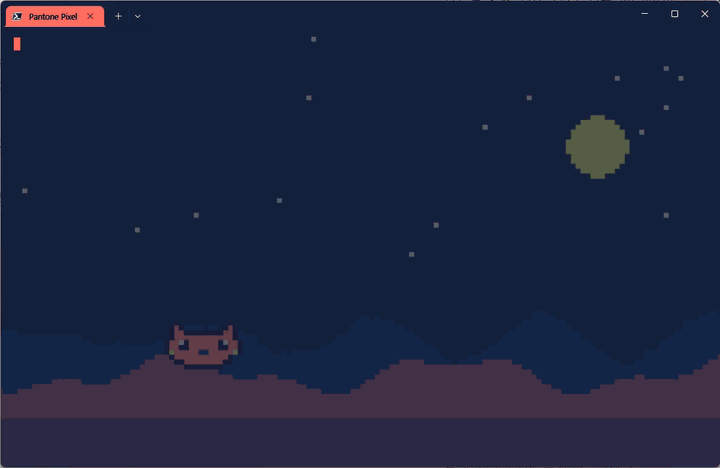

# ♥ Pantone Pixel

Pantone Color of the Year 조합으로 꾸미는 픽셀 아트 터미널 테마예요.
Windows Terminal 색상, 탭 색, Oh My Posh 프롬프트, 시작 인사말을 한 번에 바꾸고, 미니 게임도 들어 있어요.



전체 영상(1분 46초): [docs/demo/pantone-pixel-demo.mp4](docs/demo/pantone-pixel-demo.mp4)

## 설치

필요한 것: Windows 10/11, [Windows Terminal](https://aka.ms/terminal) 1.22 이상, [PowerShell 7](https://aka.ms/powershell)

```powershell
git clone https://github.com/kyuleeee/pantone-pixel
cd pantone-pixel
pwsh -File install.ps1
```

설치 프로그램은 다음 순서로 진행돼요.

1. Oh My Posh와 픽셀 폰트(DepartureMono Nerd Font)가 없으면 설치할지 물어봐요.
2. 기존 Windows Terminal 설정과 PowerShell 프로필을 `~/.pantone-pixel/backup-*`에 백업해요.
3. 이름, 테마, 캐릭터를 고르는 설정 마법사를 띄워요.

## 명령어

| 명령 | 하는 일 |
|---|---|
| `pixel` | 테마 갤러리를 보고 번호로 고르기 |
| `pixel <id>` | 바로 전환 (Tab 자동완성) |
| `pixel-char` | 캐릭터 고르기 (`auto`는 테마 기본 캐릭터) |
| `pixel-name <이름>` | 인사말에 쓰일 이름 바꾸기 |
| `pixel-run` | 미니 게임 (Space/↑ 점프, ↓ 숙이기, Q 종료) |
| `pixel-show` | 지금 캐릭터를 큰 이미지로 보여주기 |
| `pixel-show <사진>` | 사진을 테마의 팬톤 색만 쓰는 도트 그림으로 바꿔 터미널에 띄우기 (`-Pixel 6` 더 굵은 도트, `-Width 50` 크기, `-Original` 원래 색, `-NoDither` 디더링 끄기) |
| `pixel-style kitty` / `plain` | kitty 스타일(여백, 픽셀 배경, 블록 커서, 컴팩트 탭) 켜기·끄기 |
| `pixel-fx crt` / `retro` / `off` | CRT 주사선 효과 |
| `pixel-setup` | 처음 설정 마법사 다시 실행 |

## kitty 스타일

리눅스 터미널 [kitty](https://sw.kovidgoyal.net/kitty/)의 느낌을 Windows Terminal에서 재현해요. 기본으로 켜져 있어요.

- **여백:** 글자가 창 가장자리에 붙지 않아요.
- **픽셀 아트 배경:** 테마 색과 내 캐릭터로 그린 도트 풍경이 오른쪽 아래에 은은하게 깔려요. 테마나 캐릭터를 바꾸면 같이 바뀌어요.
- **터미널 안 이미지:** Windows Terminal 1.22부터 지원하는 Sixel로 진짜 이미지를 띄워요. 지원하지 않는 터미널에서는 문자로 대신 그려요.
- **CRT 효과:** `pixel-fx crt`는 주사선, 은은한 번짐, 가장자리 어둡게 효과를 주는 전용 셰이더(`crt.hlsl`)예요.

## 테마

| id | 이름 | 팬톤 조합 |
|---|---|---|
| `coral-reef` | Coral Reef | Living Coral · Classic Blue · Illuminating |
| `very-peri` | Very Peri Night | Very Peri · Ultra Violet · Rose Quartz |
| `viva-magenta` | Viva Magenta | Viva Magenta · Marsala · Honeysuckle |
| `mocha-mousse` | Mocha Mousse | Mocha Mousse · Peach Fuzz · Sand Dollar |
| `greenery` | Greenery | Greenery · Emerald · Mimosa |
| `illuminating` | Illuminating | Illuminating · Ultimate Gray · Blue Iris |
| `peach-fuzz` | Peach Fuzz (light) | Peach Fuzz · Cloud Dancer · Mocha Mousse |

HEX 값은 팬톤이 공개한 sRGB 근사값이에요. 터미널 배경은 해당 컬러를 어둡게 만든 톤이라 공식 팬톤 컬러는 아니에요.

## 나만의 테마, 캐릭터 추가

- **테마:** `PantonePixel/themes.json`에 항목을 하나 추가해요. `scheme`은 터미널 16색, `prompt`는 프롬프트 칸 색, `roles`는 캐릭터에 입힐 색이에요.
- **캐릭터:** `PantonePixel/characters.json`에 16×10 도트를 문자로 그려요. `a` 메인, `b` 보조, `c` 포인트, `w` 밝음, `k` 어둠, `g` 중간톤, `.` 투명이에요. 캐릭터는 고른 테마의 색을 입어요.

## 데모 영상 다시 만들기

```powershell
pwsh -File docs/demo/record-demo.ps1
```

새 Windows Terminal 창에서 [demo.ps1](docs/demo/demo.ps1)이 명령을 직접 타이핑하듯 실행하고, ffmpeg로 그 창을 녹화해요. 데모 중에 바뀐 테마, 캐릭터, 이름, 최고 점수는 끝나면 원래대로 돌아와요. 녹화하는 동안 창을 가리지 마세요.

## 되돌리기

```powershell
pwsh -File uninstall.ps1
```

처음 설치할 때 만든 백업으로 Windows Terminal 설정과 프로필을 복원해요.

## 라이선스와 출처

- 폰트: [Departure Mono](https://departuremono.com) (SIL OFL), [Nerd Fonts](https://www.nerdfonts.com) 패치 버전
- PANTONE®은 Pantone LLC의 상표예요. 이 프로젝트는 Pantone과 관련이 없는 개인 프로젝트이고, 컬러 이름은 참고용으로만 썼어요.


